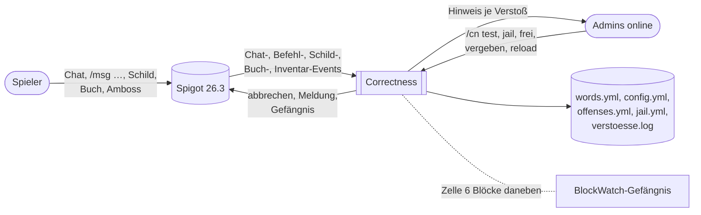

# 3. Kontextabgrenzung

| Partner | Richtung | Inhalt |
|---|---|---|
| Spigot-Events | ein | `AsyncPlayerChatEvent`, `PlayerCommandPreprocessEvent`, `SignChangeEvent`, `PlayerEditBookEvent`, `InventoryClickEvent` (Amboss-Ergebnis), Join/Respawn/Teleport für das Gefängnis |
| Spigot | aus | Events abbrechen, Teleport, Spielmodus, Zelle bauen |
| Spieler | aus | Meldung „nicht gesendet“, Verwarnung oder Gefängnis mit Countdown |
| Admins | beide | Hinweise je Verstoß (`correctness.admin`), Befehle `/cn …` |
| Dateien | beide | siehe [Verteilungssicht](07-verteilungssicht.md) |
| BlockWatch | – | Keine Code-Abhängigkeit; nur die automatische Zelle liegt bewusst daneben |

Nicht geprüft: Spielernamen, Konsole/RCON, Texte, die andere Plugins senden, Befehle, die nicht in
`befehle` stehen.
