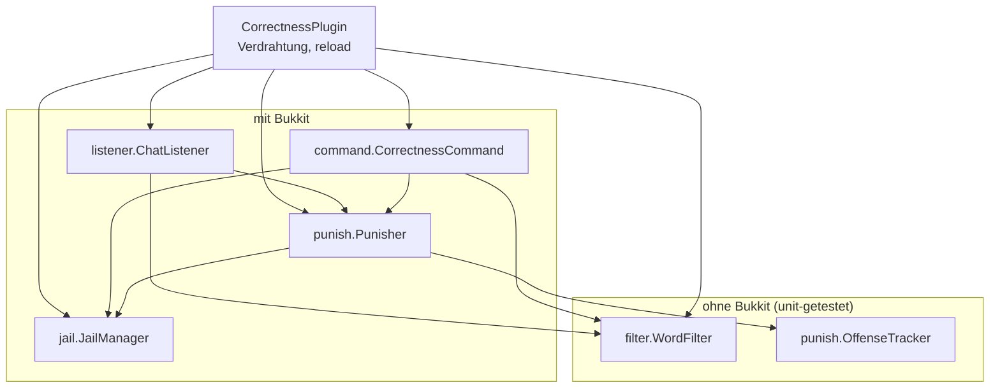

# 5. Bausteinsicht

Basis: `io.github.cndrbrbr.correctness`.

| Klasse | Verantwortung |
|---|---|
| `CorrectnessPlugin` | Start, `config.yml` mit neuen Standardwerten ergänzen, `words.yml` beim ersten Start anlegen, Filter bauen; `reload()` |
| `filter.WordFilter` | Normalisieren, Text in Wörter zerlegen (einzelne Buchstaben zusammenziehen), erstes Schimpfwort finden; unveränderlich |
| `listener.ChatListener` | Fünf Quellen prüfen, Event abbrechen, Meldung an Spieler, `Punisher` aufrufen; Quellen einzeln abschaltbar (`pruefen.*`) |
| `punish.OffenseTracker` | Zeitpunkte der Verstöße je Spieler, Verfall, Strafstufe für den n-ten Verstoß |
| `punish.Punisher` | Verstoß zählen, `offenses.yml` speichern, `verstoesse.log` schreiben, verwarnen oder einsperren, Admins benachrichtigen |
| `jail.JailManager` | Gefängnis (Kopie aus BlockWatch, Zelle 6 Blöcke neben dem Spawn, Schlüssel `jail.*` in der config) |
| `command.CorrectnessCommand` | `/correctness` bzw. `/cn`: `test`, `jail`, `frei`, `setjail`, `verstoesse`, `vergeben`, `reload` |

Tests: `WordFilterTest` (direkt, verschleiert, ganze Wörter, Ausnahmen, harmlos),
`DefaultWordsTest` (mitgelieferte `words.yml` gegen Beleidigungen und harmlose Sätze),
`OffenseTrackerTest` (Stufen, Verfall, Vergeben, kein Verfall).
