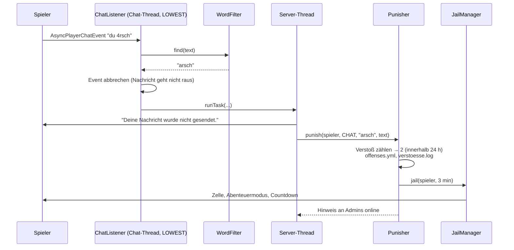

# 6. Laufzeitsicht

## 6.1 Schimpfwort im Chat (zweiter Verstoß)

Beim **ersten** Verstoß gibt es statt Gefängnis eine Verwarnung mit Ankündigung der nächsten Strafe.

## 6.2 Andere Quellen

| Quelle | Wann geprüft | Was blockiert wird |
|---|---|---|
| Chat-Befehl | `PlayerCommandPreprocessEvent`; nur Befehle aus `befehle`, Text ab dem n-ten Argument, auch mit Präfix (`/minecraft:msg`) | Befehl wird nicht ausgeführt |
| Schild | `SignChangeEvent`, alle Zeilen zusammen | Schild bleibt unbeschriftet |
| Buch | `PlayerEditBookEvent`, Titel und Seiten | Buch wird nicht gespeichert |
| Amboss | Klick auf den Ergebnis-Slot – nicht schon beim Tippen | Ergebnis nicht herausgegeben; Inventar wird im nächsten Tick geschlossen, dann bestraft |

Alle synchronen Quellen bestrafen direkt; Chat und Amboss über `runTask`, weil Teleports dort
nicht erlaubt sind (Async-Thread bzw. mitten im Inventar-Event).
